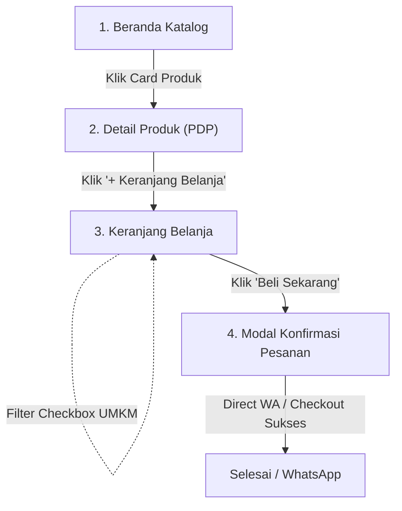

# Design System & UI Specification: Kossuma Kota Bogor

> **Koperasi Usaha Persaudaraan Muslimah Kota Bogor — Halal Food & Local UMKM E-Commerce**

Dokumen ini merupakan panduan spesifikasi teknis dan desain (*developer-ready design specification*) yang dianalisis langsung dari artefak visual yang telah diimplementasikan pada antarmuka Kossuma Kota Bogor (Beranda Katalog, Detail Produk, dan Keranjang Belanja).

---

## 1. Design Tokens

### 1.1 Color Palette

| Token Name | Hex Code | Penggunaan & Konteks UI |
| :--- | :--- | :--- |
| **Primary Brand** | `#7D3394` | Brand identity, tombol CTA utama, ikon navigasi aktif, tab aktif, checkbox terpilih. |
| **Primary Hover / Dark** | `#632676` | Status hover/active pada tombol utama CTA, border aksen gelap. |
| **Primary Surface / Tint** | `#F7F2F9` | Background kartu produsen UMKM, pill status kategori, latar belakang badge toko binaan. |
| **Brand Border Accent** | `#E2C9EB` | Border halus (1px) pada kartu UMKM binaan, banner kupon, dan input fokus. |
| **Page Background (Base)** | `#F9FAFB` | Background utama halaman Beranda dan Detail Produk (Off-White modern). |
| **Cart Page Background** | `#F3F4F6` | Background khusus halaman Keranjang Belanja untuk mempertegas pemisahan kartu toko. |
| **Card Surface** | `#FFFFFF` | Permukaan kartu produk, navbar sticky, drawer/modal, dan panel ringkasan belanja. |
| **Text Primary (Charcoal)** | `#1F2937` | Judul produk, heading utama, harga ringkasan, teks label penting. |
| **Text Secondary (Muted)** | `#6B7280` | Metadata toko, ulasan/terjual, breadcrumbs, placeholder, catatan subteks. |
| **Text Tertiary (Light)** | `#9CA3AF` | Coretan harga asli (*strikethrough discount*), ikon sekunder, divider. |
| **Marketplace Price** | `#DC2626` | Warna merah kontras tinggi untuk seluruh harga nominal produk (*Marketplace Standard*). |
| **Price Tag Background** | `#FEF2F2` | Background *soft-red tint* pembungkus display harga pada halaman Detail Produk. |
| **Badge Halal & Trust** | `#059669` / `#10B981` | Emerald green untuk indikator ketersediaan stok, verifikasi halal, dan centang pesanan berhasil. |
| **Rating Amber** | `#F59E0B` | Bintang rating ulasan produk (★ 4.9, ★ 5.0). |
| **Border Neutral** | `#E5E7EB` | Garis tepi reguler kartu (1px border pada card produk & divider antar section). |

---

### 1.2 Typography & Type Scale

**Primary Font Family:** `'Plus Jakarta Sans', -apple-system, BlinkMacSystemFont, 'Segoe UI', Roboto, sans-serif`

| Tingkatan Teks | Ukuran (Desktop) | Ukuran (Mobile) | Weight | Line Height | Keterangan & Penggunaan |
| :--- | :--- | :--- | :--- | :--- | :--- |
| **Display / Hero H1** | 32px (2rem) | 22px (1.375rem) | 800 (ExtraBold) | 1.2 | Headline Hero Banner utama |
| **Section Heading H2** | 20px (1.25rem) | 18px (1.125rem) | 800 (ExtraBold) | 1.3 | Judul section katalog & judul halaman |
| **Product Title Detail** | 24px (1.5rem) | 18px (1.125rem) | 800 (ExtraBold) | 1.3 | Judul produk pada showcase PDP |
| **Product Title Card** | 14px (0.875rem) | 13px (0.8125rem) | 600 (SemiBold) | 1.4 | Judul produk di card katalog (Max 2 baris) |
| **Price Display (Hero)** | 28px (1.75rem) | 22px (1.375rem) | 800 (ExtraBold) | 1.1 | Harga utama merah di PDP & Total Keranjang |
| **Price Display (Card)** | 16px (1rem) | 14px (0.875rem) | 800 (ExtraBold) | 1.2 | Harga nominal merah pada katalog produk |
| **Body / Description** | 14px (0.875rem) | 14px (0.875rem) | 400 / 500 | 1.6 | Deskripsi komposisi, saran penyajian |
| **Caption / Metadata** | 12px (0.75rem) | 11px (0.6875rem) | 500 (Medium) | 1.4 | Rating, jumlah terjual, lokasi toko UMKM |
| **Button Label** | 15px (0.9375rem) | 14px (0.875rem) | 700 (Bold) | 1.0 | Teks tombol CTA (+ Keranjang Belanja, Beli) |

---

### 1.3 Border Radius & Elevation (Shadows)

#### Border Radius
- **Rounded Small (`rounded-md` / `rounded-lg`):** `8px` — Card produk mobile, tag badge, input field varian kuantitas.
- **Rounded Medium (`rounded-xl`):** `12px` — Card produk desktop, panel ringkasan belanja, tombol utama.
- **Rounded Large (`rounded-2xl`):** `16px` — Kontainer showcase detail produk, kartu toko di keranjang belanja.
- **Rounded Pill (`rounded-full`):** `9999px` — Badge kategori, chips filter, stepper `+` / `-`, search bar utama.

#### Elevation / Shadows
- **Card standard:** `0 1px 3px 0 rgba(0, 0, 0, 0.04), 0 1px 2px -1px rgba(0, 0, 0, 0.04)` + border 1px `#E5E7EB`.
- **Sticky Navbar:** `0 4px 12px -2px rgba(125, 51, 148, 0.06)` (*Soft purple tint shadow*).
- **Sticky Bottom Checkout:** `0 -4px 16px 0 rgba(0, 0, 0, 0.06)` dengan pembatas atas 1px `#E5E7EB`.

---

### 1.4 Spacing & Grid Layout Rules

#### Mobile Viewport Grid
- **Lebar container target:** 390px (*Fluid responsive* 360px – 428px).
- **Padding tepi layar (*screen gutter*):** 16px (`p-4`).
- **Grid katalog produk:** 2-Kolom dengan celah (*gap*): 10px – 12px.

#### Desktop Viewport Grid
- **Lebar container maksimum:** 1200px – 1280px (`max-w-7xl mx-auto`).
- **Padding tepi layar:** 24px – 32px (`px-6` / `px-8`).
- **Grid katalog produk:** 4-Kolom seragam dengan celah (*gap*): 20px (`gap-5`).

---

## 2. Component Specifications

### 2.1 Sticky Top Header

- **Anatomi:**
  - **Brand Mark:** Ikon keranjang ungu + Teks tebal "Kossuma" (`#7D3394`) berdampingan dengan badge pill lavender bertuliskan "Kota Bogor" dan subteks "Koperasi Usaha Persaudaraan Muslimah".
  - **Search Input Bar:** Field dengan radius `rounded-full`, border netral `#E5E7EB`, ikon kaca pembesar, dan teks placeholder *"Cari risol mayo, ayam ungkep, ikan nila..."*.
  - **Shopping Cart Action:** Ikon outline shopping cart murni tanpa teks, dilengkapi badge counter merah `#DC2626` di sudut kanan atas yang menampilkan jumlah item aktif (misal: `"2"`).
- **Behavior:** `position: sticky; top: 0; z-index: 50;` berlatar belakang `#FFFFFF` dengan backdrop blur halus.

---

### 2.2 Clean Product Card (Katalog Standar)

- **Aturan Visual Mutlak:**
  - **Rasio Foto 1:1 (Square):** Foto makanan bersih, pencahayaan alami, tanpa elemen overlay teks diskon, tanpa stiker coret harga di atas foto, dan tanpa tombol `+ Add` yang menutupi gambar.
  - **Judul Produk (Title Clamping):** Maksimal 2 baris menggunakan CSS `line-clamp-2` / `-webkit-line-clamp: 2; overflow: hidden; text-overflow: ellipsis;`.
  - **Marketplace Price Tag:** Teks harga merah tebal `#DC2626` (`font-weight: 800`) diletakkan di bawah judul produk.
  - **Metadata Row:** Ikon bintang amber (`#F59E0B`) + nilai ulasan (misal: `★ 4.9 • 850 terjual`), baris kedua mencantumkan nama UMKM mitra binaan (misal: *Pawon Ibu Fatimah — Semplak*).

---

### 2.3 Sticky Horizontal Category Tabs

- **Anatomi:** Deretan tab horizontal scrollable: *"Semua"*, *"Frozen Food"*, *"Ayam"*, *"Ikan"*, *"Lauk Matang"*, *"Kue & Camilan"*, *"Bumbu & Sambal"*.
- **State Aktif:**
  - Teks tebal berwarna ungu `#7D3394`.
  - Indikator garis bawah solid setebal 3px dengan warna `#7D3394`.
- **State Inaktif:** Teks abu-abu netral `#6B7280`, tanpa garis bawah, dengan efek hover `#1F2937`.

---

### 2.4 Product Detail Page (PDP) Layout

- **Hero Media:** Galeri foto 1:1 resolusi tinggi di sebelah kiri (desktop) atau full-width (mobile), dilengkapi strip thumbnail pendukung dan badge audit halal LPPOM / BPJPH.
- **Info Box Harga:** Display latar belakang merah lembut `#FEF2F2` dengan teks harga merah Rp65.000, perbandingan coretan harga diskon, dan tag hemat.
- **Kartu UMKM Binaan:** Box latar belakang `#F7F2F9` dengan border aksen `#E2C9EB`, badge terverifikasi UMKM binaan, nama dapur pembuat, lokasi kecamatan, dan tombol kunjungi dapur binaan.
- **Detail Akordeon:** Tab deskripsi bahan alami tanpa MSG/pengawet sintetis, serta tata cara penyajian praktis (thawing, suhu penggorengan, opsi air-fryer).

---

### 2.5 Store-Grouped Cart Cards

- **Struktur Hirarki Multi-Vendor:**
  - Produk dikelompokkan secara rapi per unit dapur anggota UMKM binaan (misal: *Dapur Ummi Salma — Tanah Sareal* terpisah dari *Pawon Ibu Fatimah — Bogor Barat*).
  - **Header Toko:** Checkbox ungu `#7D3394` selektif per toko, badge solid ungu `✓ UMKM Binaan`, dan estimasi pengiriman lokal sameday.
  - **Baris Item:** Checkbox item, thumbnail 1:1 (64px mobile / 96px desktop), judul produk 2 baris, dropdown pill pilihan varian berat, harga nominal merah tebal, dan stepper kuantitas interaktif.
- **Quantity Stepper:** Tombol minus berubah menjadi ikon tempat sampah (`🗑️`) saat kuantitas bernilai 1 untuk konfirmasi hapus item.
- **Input Catatan:** Kotak input bertuliskan placeholder untuk instruksi khusus ke produsen (misal: *minta kirim beku / pisahkan saus*).

---

### 2.6 Fixed Bottom Action Bars

- **Desktop:** Bilah checkout terintegrasi dalam panel ringkasan belanja di kolom kanan (*sticky sidebar*).
- **Mobile:** Bilah melayang di dasar layar (`bottom: 0`) dengan ringkasan checkbox *"Pilih Semua"*, subtotal harga merah, dan tombol aksi ungu Kossuma `#7D3394`.

---

## 3. Screen-by-Screen Layout & User Flow

```
[ 1. Beranda Katalog ]
       │
       ▼ (Klik Card Produk)
[ 2. Detail Produk (PDP) ]
       │
       ▼ (Klik "+ Keranjang Belanja")
[ 3. Keranjang Belanja ] ──► (Filter Checkbox UMKM)
       │
       ▼ (Klik "Beli Sekarang")
[ 4. Modal Konfirmasi Pesanan ] ──► (Direct WA / Checkout Sukses)
```



### Penjelasan Halaman

- **Beranda Katalog (*Beranda Katalog Kossuma Kota Bogor*):**
  - Berfungsi sebagai etalase kurasi digital produk pangan halal dan frozen food UMKM perempuan Kota Bogor.
  - Mengarahkan pengguna melalui hero banner penawaran, tab kategori bahan pokok & camilan, serta daftar katalog terlaris.

- **Detail Produk (*Detail Produk - Ayam Ungkep Bumbu Kuning*):**
  - Menyajikan informasi transparansi sertifikasi halal, spesifikasi porsi/berat, profil dapur UMKM pembuat, instruksi penggorengan, dan stepper pembelian langsung.

- **Keranjang Belanja (*Keranjang Belanja - Kossuma Kota Bogor*):**
  - Memisahkan item berdasarkan dapur UMKM asal untuk memudahkan perhitungan ongkos kirim lokal Bogor Sameday.
  - Dilengkapi progress bar promo bebas ongkir se-Kota Bogor dan rekomendasi item pelengkap (*cross-selling*).

- **Modal Konfirmasi Pesanan:**
  - Memverifikasi ringkasan akhir pesanan syariah, detail donasi infaq berkah pemberdayaan ekonomi perempuan, dan tautan langsung pemesanan ke kurir koperasi.

---

## 4. Do's & Don'ts (Konsistensi Desain)

### Do's (Wajib Diterapkan)

- **Gunakan Warna Merah `#DC2626` Khusus Harga:** Seluruh nominal harga produk di katalog, PDP, maupun checkout ringkasan wajib menggunakan warna merah tebal untuk kontras maksimal.
- **Pertahankan Foto Bersih 1:1:** Seluruh visual makanan harus tampil autentik tanpa stiker promo yang menempel di atas objek foto.
- **Tampilkan Identitas UMKM Binaan:** Selalu cantumkan nama dapur produsen dan kecamatan asal (misal: *Tanah Sareal*, *Bogor Barat*) untuk memperkuat misi pemberdayaan lokal.
- **Batasi Judul Produk 2 Baris:** Wajib menerapkan 2-line clamp pada kartu katalog agar tinggi kartu tetap simetris dan sejajar di seluruh viewport.
- **Pertahankan Brand Purple `#7D3394`:** Gunakan ungu Kossuma secara konsisten pada komponen interaktif utama (tombol CTA, indikator aktif, dan checkbox).

### Don'ts (Dilarang)

- **DILARANG Menambahkan Tombol "+ Keranjang" di Card Katalog:** Card katalog dibuat bersih tanpa tombol pembelian langsung agar pengguna membaca detail porsi/varian terlebih dahulu.
- **DILARANG Menggunakan Warna Hijau untuk Harga:** Warna hijau hanya diperuntukkan bagi status stok, sertifikasi halal, dan notifikasi sukses.
- **DILARANG Mengubah Font Family:** Jangan mencampur font lain selain *Plus Jakarta Sans*.
- **DILARANG Menempatkan Overlay Badge di Atas Gambar Produk:** Badge diskon atau label promo tidak boleh menutupi estetika foto kuliner.
- **DILARANG Menggabungkan Produk Lintas Toko Tanpa Header:** Dalam keranjang belanja, item dari dapur berbeda tidak boleh digabung dalam satu list tanpa pemisah nama UMKM binaan.
