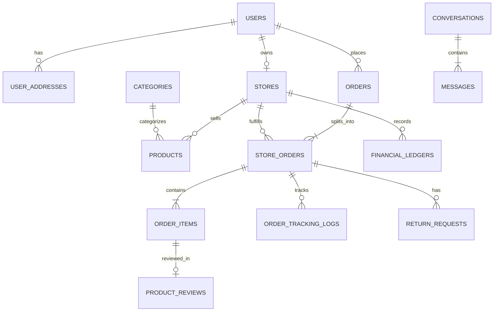
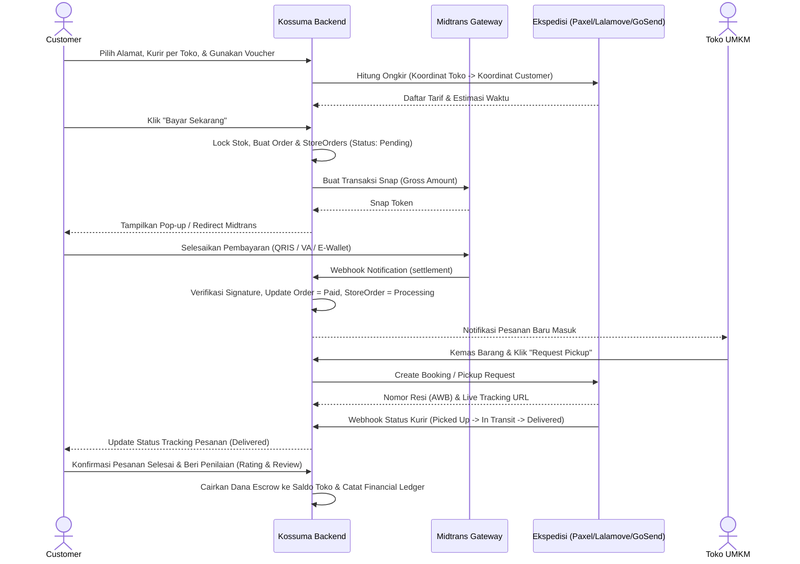
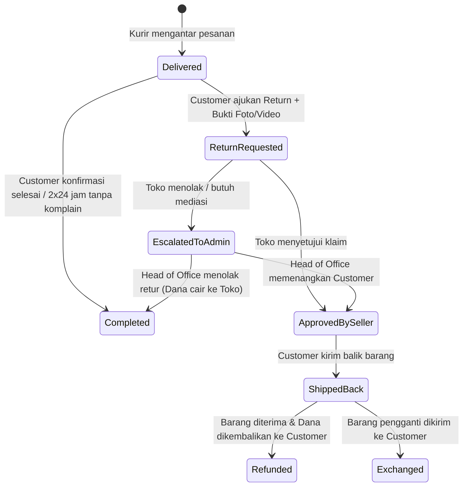

# Product Requirements Document (PRD): Kossuma Marketplace

| Metadata | Detail |
| :--- | :--- |
| **Nama Proyek** | Kossuma Marketplace |
| **Versi Dokumen** | 1.0.0 |
| **Status** | Approved for Development |
| **Target Pembaca** | AI Coding Agents, Backend/Frontend Engineers, QA Engineers |
| **Warna Aksen Utama** | `#7D3394` (Kossuma Royal Purple) |
| **Tech Stack Utama** | Laravel 13 (PHP 8.5), Inertia.js v3, React 19 (TypeScript), Tailwind CSS v4, Laravel Fortify, Laravel Wayfinder, Pest v5 |

---

## 1. Executive Summary & Visi Produk

**Kossuma Marketplace** adalah platform e-commerce multi-tenant terpusat (*managed marketplace*) yang dibangun khusus untuk menaungi jaringan UMKM di bawah manajemen **Kossuma (Head of Store / Head of Office)**. Berbeda dengan marketplace terbuka pada umumnya, Kossuma bertindak sebagai induk organisasi (*principal/aggregator*) yang mengkurasi, memonitor, dan mengelola arus transaksi serta kualitas layanan dari seluruh toko UMKM binaan.

Tujuan utama platform ini adalah menyederhanakan proses jual-beli dan operasional melalui tiga pilar pengguna:
1. **Customer (Pembeli):** Pengalaman belanja produk UMKM yang mudah, aman, transparan (ready stock & pre-order), dengan dukungan pengiriman instan/kurir terintegrasi dan jaminan purnajual (retur).
2. **Toko (Mitra UMKM Kossuma):** Kemudahan manajemen katalog, stok, status produk (Ready, Pre-Order, Best Seller, Diskon), komunikasi langsung dengan pembeli maupun Head of Office, serta visibilitas laporan penjualan toko.
3. **Head of Office (Management Kossuma):** Kendali penuh atas ekosistem (*super-admin*), pemantauan KPI performa seluruh toko (toko teramai vs. kurang aktif), manajemen kampanye diskon hari tertentu, penyelesaian sengketa/retur, dan laporan keuangan komprehensif terpusat.

---

## 2. Arsitektur Teknis & Konvensi Pengembangan (Panduan AI Agent)

Bagian ini wajib diikuti oleh AI Agent dan developer saat mengimplementasikan fitur di dalam repositori ini:

### 2.1. Stack Aplikasi Saat Ini
- **Backend:** Laravel 13 (`PHP ^8.3 / 8.5`), menggunakan `laravel/fortify` untuk autentikasi (termasuk 2FA & Passkeys) dan `laravel/wayfinder` untuk pembuatan *typed route functions* di TypeScript.
- **Frontend:** React 19 + TypeScript dengan **Inertia.js v3** (`@inertiajs/react`) dan **Tailwind CSS v4** (`@tailwindcss/vite`) + komponen berbasis Radix UI (`@radix-ui/*`) dan ikon `lucide-react`.
- **Testing & Quality:** Pest v5 (`pestphp/pest`), PHPStan/Larastan level tinggi, dan Laravel Pint.

### 2.2. Prinsip Arsitektur
- **Single Codebase, Multi-Role Portal:**
  - `/` & `/catalog/*`, `/cart`, `/checkout`, `/orders/*`, `/profile/*` -> Area **Customer**.
  - `/store-panel/*` -> Area **Toko UMKM (Seller)**.
  - `/admin/*` (Head of Office) -> Area **Head of Office Management**.
- **Service & Action Pattern:**
  - Gunakan class Action/Service terpisah untuk logika bisnis krusial (misal: `App\Actions\Order\CreateCheckoutAction`, `App\Services\Payment\MidtransService`, `App\Services\Shipping\ShippingAggregatorService`).
- **Database Transactions & Locking:**
  - Operasi pengurangan stok, pembuatan order, dan pencatatan mutasi keuangan **wajib** menggunakan `DB::transaction()` dan `lockForUpdate()` untuk mencegah *race condition* (*overselling*).
- **Nilai Uang (Monetary Values):**
  - Simpan seluruh nominal harga, diskon, ongkos kirim, dan saldo dalam tipe `BIGINT` (satuan Rupiah penuh tanpa desimal mengambang, contoh: `150000` untuk Rp150.000) guna menghindari *floating-point rounding error*.

---

## 3. Sistem Desain & Identitas Visual (UI/UX Guidelines)

### 3.1. Palet Warna (Color Tokens)
Warna utama menggunakan **Kossuma Purple (`#7D3394`)**. Konfigurasikan variabel CSS / tema Tailwind v4 di `resources/css/app.css`:

| Token | Hex / Nilai | Penggunaan |
| :--- | :--- | :--- |
| `--primary` / `brand-600` | `#7D3394` | CTA Utama (Tombol Beli, Checkout, Simpan), Badge Aktif, Link Utama, Header Aksen |
| `brand-50` | `#F9F5FB` | Latar belakang highlight tipis, hover item menu, background badge ringan |
| `brand-100` | `#F0E6F5` | Border komponen aktif, background chip kategori terpilih |
| `brand-500` | `#9342AF` | Hover state alternatif / gradien sekunder |
| `brand-700` | `#632676` | Hover state tombol utama (`hover:bg-[#632676]`) |
| `brand-900` | `#3D164A` | Teks aksen gelap, sidebar Head of Office |
| `success` | `#10B981` | Status *Ready Stock*, Pembayaran Berhasil, Pesanan Selesai |
| `warning` | `#F59E0B` | Status *Pre-Order (PO)*, Menunggu Pembayaran, Pengajuan Retur |
| `danger` | `#EF4444` | Stok Habis, Pembayaran Gagal, Komplain/Retur Ditolak |

### 3.2. Komponen UI Khas Kossuma
- **Product Card:** Menampilkan foto rasio `1:1`, badge **Best Seller** (emas/ungu), badge **Pre-Order** (kuning amber dengan estimasi hari) atau **Ready** (hijau), harga coret jika sedang diskon, nama toko UMKM + kota/lokasi, serta rating bintang.
- **Responsive Layout:**
  - *Customer:* Mobile-first dengan *bottom navigation bar* di layar kecil dan *sticky header* (Search bar + Cart counter + Chat icon) di desktop.
  - *Toko & Head of Office:* Dashboard layout dengan *collapsible sidebar*, tabel data dengan filter periode, dan kartu KPI ringkas.

---

## 4. Peran Pengguna & Hak Akses (RBAC)

Sistem memiliki 3 peran utama (`UserRole` Enum: `Customer`, `Seller`, `HeadOffice`):

| Kapabilitas | Customer | Toko (UMKM) | Head of Office (Kossuma) |
| :--- | :---: | :---: | :---: |
| Menjelajahi katalog, mencari & filter produk | Ya | Ya | Ya |
| Checkout, pilih kurir, bayar via Midtrans, pakai voucher | Ya | Tidak (kecuali akun customer) | Tidak |
| Mengelola produk, stok, harga, lokasi, label (PO/Ready/Best Seller/Diskon) | Tidak | Hanya tokonya sendiri | Semua toko (Override/Moderasi) |
| Chat Customer <-> Toko | Ya | Ya (Tokonya) | Read-only / Audit bila sengketa |
| Chat Toko <-> Head of Office | Tidak | Ya | Ya |
| Menangani pengajuan Return Barang | Mengajukan & kirim bukti | Meninjau & merespons | Keputusan final / Escalation & Refund |
| Mengelola Diskon Hari Tertentu & Voucher Global | Tidak | Partisipasi / Diskon Toko | Buat & Kelola Penuh |
| Melihat Laporan Keuangan | Histori belanja pribadi | Khusus tokonya sendiri | Komprehensif (Seluruh UMKM + Komisi/Payout) |
| Dashboard KPI Performa & Keramaian Toko | Tidak | Ringkasan tokonya | Seluruh toko (Ranking teramai & sepi) |

---

## 5. Spesifikasi Fitur Fungsional (Functional Requirements)

### 5.1. Modul Katalog, Kategori, & Manajemen Produk (Fitur Utama #1 & #2)
- **FR-CAT-01 (Struktur Kategori):** Produk dikelompokkan berdasarkan kategori hierarkis atau flat (misal: Kuliner Kemasan, Kuliner Basah/Frozen, Kriya & Kerajinan, Fashion UMKM, Herbal & Kesehatan) yang dapat diurutkan berdasarkan prioritas tampil (`sort_order`).
- **FR-CAT-02 (Pencarian & Filter Lengkap):**
  - Pencarian *full-text* berdasarkan nama produk, deskripsi, atau nama toko UMKM.
  - Filter berdasarkan: Kategori, Rentang Harga (`min_price`, `max_price`), Status Ketersediaan (`Ready Stock`, `Pre-Order`), Label (`Best Seller`, `Sedang Diskon`), Lokasi Toko, dan Rating minimum (misal: 4 ke atas).
  - Pengurutan (*Sorting*): Terbaru, Terlaris (*Best Seller*), Harga Terendah, Harga Tertinggi, Rating Tertinggi.
- **FR-PROD-01 (Atribut Produk UMKM):**
  - Setiap produk memiliki: Nama, Slug unik, Kategori, Deskripsi, Foto multi-gambar (maks. 5 foto, 1 foto utama), Harga Dasar (`base_price`), Berat (gram) & Dimensi (`length`, `width`, `height` untuk kalkulasi kurir), Stok tersedia (`stock`), serta **Lokasi Pengiriman Produk** (mengacu pada titik koordinat `latitude, longitude` & alamat toko UMKM).
- **FR-PROD-02 (Status Ready vs Pre-Order):**
  - Toko dapat mengatur tipe ketersediaan produk (`availability_type`: `Ready` atau `PreOrder`).
  - Jika `PreOrder`, toko wajib mengisi `preorder_duration_days` (misal: 3 hari atau 7 hari) dan opsional kuota PO. Sistem menampilkan estimasi tanggal pengiriman secara otomatis kepada Customer saat checkout.
- **FR-PROD-03 (Flagging Produk oleh Toko):**
  - Toko dapat menandai produknya sebagai **Best Seller** (`is_best_seller`), mengatur **Harga Diskon Toko** (`discount_price` beserta periode aktif), dan mengubah status **Ready / Pre-Order**.

### 5.2. Modul Kampanye Diskon Hari Tertentu & Voucher (Fitur Utama #7 & Customer #4)
- **FR-PROMO-01 (Diskon Hari Tertentu / Scheduled Day Discounts):**
  - Sistem mendukung kampanye diskon berbasis jadwal hari tertentu, contoh: *"Jumat Berkah UMKM"*, *"Promo Gajian Tanggal 25"*, *"Harbolnas"*, atau diskon mingguan berdasarkan hari (`applicable_days`: array hari `['Monday', 'Friday']` atau rentang tanggal spesifik + jam aktif `start_time` - `end_time`).
  - Saat hari/jam tersebut aktif, harga produk yang terdaftar dalam program diskon otomatis terpotong di katalog dan keranjang tanpa perlu input kode manual.
- **FR-PROMO-02 (Sistem Voucher):**
  - Customer dapat memasukkan kode voucher pada halaman keranjang/checkout.
  - Jenis voucher: Potongan Persentase (dengan batas maksimum potongan `max_discount_amount`), Potongan Nominal Tetap, atau Potongan Ongkos Kirim.
  - Validasi voucher mencakup: Masa berlaku, hari aktif tertentu, minimal belanja (`min_purchase_amount`), kuota total, kuota per customer, serta cakupan (berlaku untuk seluruh toko Kossuma atau khusus toko UMKM tertentu).

### 5.3. Modul Profil Customer, Keranjang, & Multi-Store Checkout (Customer #1, #3, #5, #7)
- **FR-CUST-01 (Manajemen Profil & Multi-Alamat):**
  - Customer memiliki profil berisi nama lengkap, email, foto profil, dan nomor telepon/WhatsApp terverifikasi.
  - Customer dapat menyimpan banyak alamat pengiriman (`user_addresses`), menandai satu alamat sebagai alamat utama (`is_default`), serta menyimpan titik koordinat (`latitude`, `longitude`), kode pos, kecamatan, kota, dan catatan patokan kurir (penting untuk pengiriman instan GoSend/Lalamove dan Paxel).
- **FR-CART-01 (Keranjang Belanja Multi-Toko):**
  - Customer dapat menambahkan produk dari satu atau beberapa toko UMKM ke dalam keranjang.
  - Di dalam keranjang, item dikelompokkan secara visual per **Toko UMKM**.
  - Validasi *real-time*: Mencegah kuantitas melebihi stok tersedia; memberikan informasi jika terdapat campuran produk *Ready* dan *Pre-Order*.
- **FR-CHK-01 (Arsitektur Order Induk & Sub-Order per Toko):**
  - Karena setiap UMKM memiliki lokasi fisik berbeda, pengiriman dilakukan dari lokasi masing-masing toko ke alamat Customer.
  - Satu proses Checkout menghasilkan:
    1. Satu **`Order` (Invoice Induk / Payment Group)** untuk satu kali pembayaran terpadu di Midtrans.
    2. Satu atau lebih **`StoreOrder` (Pesanan per Toko)** yang masing-masing memiliki pilihan kurir, ongkos kirim, nomor resi, dan status pengiriman tersendiri.

### 5.4. Integrasi Pembayaran Midtrans (Fitur Utama #4 & Customer #5)
- **FR-PAY-01 (Midtrans Snap / Core API Integration):**
  - Mendukung metode pembayaran lengkap: Virtual Account (BCA, Mandiri, BNI, BRI, Permata), QRIS, E-Wallet (GoPay, ShopeePay), dan Kartu Kredit/Debit.
- **FR-PAY-02 (Siklus Hidup Pembayaran & Webhook):**
  - Saat checkout dikonfirmasi, sistem membuat transaksi ke Midtrans dan menyimpan `snap_token` serta `payment_expired_at`.
  - Endpoint Webhook (`POST /api/webhooks/midtrans`) memverifikasi `signature_key` (`SHA512(order_id + status_code + gross_amount + ServerKey)`).
  - Transisi status otomatis:
    - `settlement` / `capture` -> Status pembayaran menjadi `Paid`, seluruh `StoreOrder` terkait berubah menjadi `Processing` (diteruskan ke masing-masing toko UMKM), dan dana dicatat ke buku besar (*Escrow/Holding Balance* Kossuma).
    - `expire` / `cancel` / `deny` -> Status menjadi `Cancelled` / `Expired`, stok produk & kuota voucher dikembalikan (*auto-restock*) secara atomik.

### 5.5. Integrasi Ekspedisi & Pelacakan Pesanan (Fitur Utama #5, #6 & Customer #6, #8)
- **FR-SHIP-01 (Abstraksi Layanan Ekspedisi - `ShippingProviderInterface`):**
  - Sistem mengintegrasikan tiga mitra logistik utama sesuai kebutuhan UMKM:
    1. **Paxel:** Pengiriman sameday/nextday antarkota & dalam kota (cocok untuk makanan/frozen food UMKM), menggunakan berbasis berat/dimensi (Small, Medium, Large) dan kode area/koordinat.
    2. **Lalamove:** Pengiriman instan/sameday berbasis jarak koordinat (`latitude/longitude` toko ke customer) dengan pilihan armada (Motor, Sedan, Van/Pickup untuk pesanan besar).
    3. **GoSend:** Pengiriman Instant & Same Day dalam kota berbasis titik koordinat.
- **FR-SHIP-02 (Cek Ongkir Real-Time):**
  - Pada halaman Checkout, setelah Customer memilih alamat pengiriman, sistem menghitung jarak/tarif dari lokasi masing-masing Toko UMKM ke alamat Customer dan menampilkan daftar layanan beserta estimasi biaya (`shipping_cost`) dan estimasi waktu tiba (`etd`).
- **FR-SHIP-03 (Request Pickup & Tracking Pesanan):**
  - Saat Toko menekan tombol **"Siap Dikirim / Request Pickup"**, sistem memanggil API booking kurir terkait untuk mendapatkan Nomor Resi / AWB (`tracking_number`) dan URL Live Tracking (`tracking_url` untuk kurir instan).
  - Webhook kurir (`POST /api/webhooks/shipping/{provider}`) memperbarui histori status pengiriman (`OrderTrackingLog`): `Menunggu Pickup` -> `Kurir Menuju Lokasi` -> `Barang Diambil` -> `Dalam Perjalanan` -> `Terkirim (Delivered)`.
  - Customer dapat memantau timeline status pengiriman beserta bukti foto pengiriman dari halaman detail pesanan.

### 5.6. Modul Komunikasi / Chat Terintegrasi (Fitur Utama #3, Customer #10, Toko #2 & #4)
- **FR-CHAT-01 (Dua Jalur Komunikasi):**
  1. **Customer <-> Toko UMKM:** Customer dapat menghubungi toko untuk menanyakan ketersediaan produk atau detail pesanan. Dapat melampirkan tautan produk atau nomor pesanan (`store_order_id`).
  2. **Toko UMKM <-> Head of Office Kossuma:** Kanal komunikasi internal antara pengelola toko UMKM dengan manajemen pusat Kossuma (untuk koordinasi stok, pencairan dana, promosi, atau kendala operasional).
- **FR-CHAT-02 (Fitur Ruang Pesan):**
  - Mendukung pesan teks, lampiran gambar (bukti produk/kemasan), indikator pesan belum dibaca (*unread badge*), dan penanda waktu (*timestamp*).
  - Implementasi dapat menggunakan polling ringan Inertia (`usePoll` di Inertia v3) atau Laravel Reverb/Broadcast untuk pembaruan pesan mendekati *real-time*.

### 5.7. Modul Return Barang & Resolusi Masalah (Fitur Utama #9 & Customer #11)
- **FR-RET-01 (Pengajuan Return oleh Customer):**
  - Untuk pesanan berstatus `Delivered` (sebelum batas waktu penyelesaian otomatis, misal 2x24 jam), Customer dapat mengajukan **Return Barang** jika barang rusak, salah kirim, kurang, atau tidak sesuai deskripsi.
  - Customer wajib memilih item yang bermasalah, alasan retur, solusi yang diinginkan (`Refund Dana` atau `Tukar Barang Baru`), deskripsi kendala, dan mengunggah foto/video bukti unboxing (`return_evidences`).
- **FR-RET-02 (Alur Persetujuan & Eskalasi):**
  - Selama pengajuan retur aktif (`Requested`, `ApprovedBySeller`, `ShippedBack`), pencairan dana (*settlement*) pesanan tersebut ke saldo Toko ditahan (*on-hold*).
  - Toko dapat menyetujui retur atau mengajukan banding ke **Head of Office**.
  - **Head of Office** memiliki wewenang final (`AdminResolved`) untuk memutuskan apakah dana dikembalikan ke Customer (*refund*) atau diteruskan ke Toko.

### 5.8. Modul Ulasan & Penilaian (Customer #12)
- **FR-REV-01 (Penilaian Pesanan Selesai):**
  - Setelah status pesanan menjadi `Completed` (baik dikonfirmasi langsung oleh Customer atau otomatis setelah masa garansi selesai tanpa komplain), Customer dapat memberikan rating bintang (`1` s/d `5`), ulasan teks, dan foto produk untuk setiap item yang dibeli.
  - Sistem otomatis memperbarui rata-rata rating produk (`products.rating_avg`) dan rating toko (`stores.rating_avg`).

### 5.9. Modul Laporan Keuangan & KPI Management (Fitur Utama #8, Toko #3, Head of Office #1, #2, #3)
- **FR-FIN-01 (Laporan Khusus Toko UMKM):**
  - Toko dapat melihat ringkasan pendapatan kotor, potongan biaya layanan/komisi Kossuma (jika ada), pendapatan bersih, daftar transaksi selesai, dana yang masih ditahan (*escrow*), dan riwayat pencairan dana (*payout/withdrawal*), lengkap dengan filter rentang tanggal.
- **FR-FIN-02 (Laporan Keuangan Komprehensif Head of Office):**
  - Head of Office memiliki dashboard keuangan menyeluruh yang menampilkan:
    - **Total Gross Merchandise Value (GMV):** Total nilai transaksi seluruh UMKM.
    - **Total Net Revenue / Komisi Kossuma:** Pendapatan manajemen (bila menerapkan skema bagi hasil/biaya admin).
    - **Rekapitulasi Biaya Ekspedisi & Diskon/Subsidi Voucher:** Memisahkan beban diskon yang ditanggung pusat vs. ditanggung toko.
    - **Rekapitulasi Refund/Return:** Nilai kerugian atau pengembalian dana akibat retur.
    - **Mutasi Buku Besar (Financial Ledger) & Ekspor Data:** Tabel mutasi lengkap per transaksi yang dapat diekspor ke CSV/Excel/PDF untuk keperluan audit akuntansi.
- **FR-KPI-01 (Analitik & KPI Performa Toko untuk Head of Office):**
  - Dashboard KPI khusus untuk mengevaluasi toko UMKM mana yang **paling ramai (Top Performing)** dan **paling sepi / butuh pembinaan (Underperforming)** berdasarkan metrik:
    1. **Volume Pesanan & GMV:** Jumlah pesanan berhasil dan total omzet per periode.
    2. **Conversion Rate & Traffic Produk:** Jumlah produk dilihat vs. dibeli.
    3. **Order Fulfillment Speed:** Rata-rata kecepatan toko memproses pesanan hingga diserahkan ke kurir.
    4. **Return/Issue Rate:** Persentase pesanan yang berakhir retur/komplain.
    5. **Customer Satisfaction Score:** Rata-rata rating ulasan pelanggan.
  - Dilengkapi indikator status visual: *Toko Sangat Aktif/Ramai*, *Stabil*, *Sepi / Perlu Pembinaan*, dan *Bermasalah (Tingkat Retur Tinggi)*.

---

## 6. Rancangan Skema Database (Database Schema Blueprint)

Berikut adalah rancangan entitas utama sebagai acuan pembuatan migration dan model Eloquent:



### 6.1. Tabel Inti & Kolom Kunci

1. **`users`**
   - `id`, `name`, `email`, `phone`, `role` (`Customer`, `Seller`, `HeadOffice`), `avatar_path`, `email_verified_at`, `password`, `two_factor_*`, `timestamps`.
2. **`user_addresses`**
   - `id`, `user_id`, `label` (Rumah/Kantor), `recipient_name`, `phone`, `full_address`, `province`, `city`, `district`, `postal_code`, `latitude` (`decimal 10,8`), `longitude` (`decimal 11,8`), `notes`, `is_default` (`boolean`), `timestamps`.
3. **`stores`** (Toko UMKM Kossuma)
   - `id`, `user_id` (pemilik), `name`, `slug`, `description`, `logo_path`, `banner_path`, `phone`, `full_address`, `city`, `postal_code`, `latitude`, `longitude`, `is_active` (`boolean`), `commission_rate` (`decimal 5,2`, default `0`), `balance` (`bigint`), `rating_avg` (`decimal 3,2`), `total_sales_count` (`integer`), `timestamps`.
4. **`categories`**
   - `id`, `parent_id` (nullable), `name`, `slug`, `icon`, `image_path`, `sort_order` (`integer`), `is_active` (`boolean`), `timestamps`.
5. **`products`**
   - `id`, `store_id`, `category_id`, `name`, `slug`, `sku`, `description`, `base_price` (`bigint`), `discount_price` (`bigint`, nullable), `discount_starts_at`, `discount_ends_at`, `stock` (`integer`), `weight_grams` (`integer`), `length_cm`, `width_cm`, `height_cm`, `availability_type` (`Ready`, `PreOrder`), `preorder_duration_days` (`integer`, nullable), `location_city` (`string`), `is_best_seller` (`boolean`), `is_active` (`boolean`), `rating_avg` (`decimal 3,2`), `reviews_count` (`integer`), `sold_count` (`integer`), `views_count` (`bigint`), `timestamps`.
6. **`product_images`**
   - `id`, `product_id`, `image_path`, `is_primary` (`boolean`), `sort_order` (`integer`), `timestamps`.
7. **`scheduled_discounts`** (Diskon Hari Tertentu)
   - `id`, `created_by` (HeadOffice/Seller), `store_id` (nullable jika global), `name`, `description`, `discount_type` (`Percentage`, `FixedAmount`), `discount_value` (`bigint`), `max_discount_amount` (`bigint`, nullable), `applicable_days` (`json`, misal `["Friday", "Saturday"]`), `specific_dates` (`json`, nullable), `start_time` (`time`), `end_time` (`time`), `starts_at` (`timestamp`), `ends_at` (`timestamp`), `is_active` (`boolean`), `timestamps`.
8. **`scheduled_discount_product`** (Pivot)
   - `id`, `scheduled_discount_id`, `product_id`, `custom_discount_value` (nullable).
9. **`vouchers`**
   - `id`, `store_id` (nullable untuk voucher global Kossuma), `code` (unique), `name`, `target_type` (`ProductPrice`, `ShippingCost`), `discount_type` (`Percentage`, `FixedAmount`), `discount_value` (`bigint`), `min_purchase_amount` (`bigint`), `max_discount_amount` (`bigint`, nullable), `applicable_days` (`json`, nullable), `usage_limit` (`integer`), `used_count` (`integer`), `per_user_limit` (`integer`), `starts_at`, `expires_at`, `is_active` (`boolean`), `timestamps`.
10. **`carts` & `cart_items`**
    - `carts`: `id`, `user_id`, `voucher_id` (nullable), `timestamps`.
    - `cart_items`: `id`, `cart_id`, `product_id`, `quantity` (`integer`), `timestamps`.
11. **`orders`** (Transaksi Pembayaran Terpadu)
    - `id`, `invoice_number` (unique, misal `INV/20261112/KSM-0001`), `user_id`, `shipping_address_snapshot` (`json`), `subtotal_amount` (`bigint`), `total_discount_amount` (`bigint`), `total_shipping_amount` (`bigint`), `grand_total_amount` (`bigint`), `voucher_id` (nullable), `voucher_code` (nullable), `payment_status` (`Pending`, `Paid`, `Failed`, `Expired`, `Refunded`), `payment_method` (nullable), `midtrans_transaction_id` (nullable), `midtrans_snap_token` (nullable), `paid_at`, `payment_expired_at`, `timestamps`.
12. **`store_orders`** (Sub-Order per Toko UMKM & Pengiriman)
    - `id`, `order_id`, `store_id`, `store_order_number` (unique), `status` (`AwaitingPayment`, `Processing`, `ReadyToShip`, `Shipped`, `Delivered`, `Completed`, `ReturnRequested`, `Returned`, `Cancelled`), `has_preorder` (`boolean`), `estimated_dispatch_date` (`date`, nullable), `courier_provider` (`Paxel`, `Lalamove`, `GoSend`), `courier_service` (`string`), `shipping_cost` (`bigint`), `tracking_number` (nullable), `tracking_url` (nullable), `subtotal_amount` (`bigint`), `discount_amount` (`bigint`), `platform_fee_amount` (`bigint`), `net_store_amount` (`bigint`), `shipped_at`, `delivered_at`, `completed_at`, `timestamps`.
13. **`order_items`**
    - `id`, `store_order_id`, `product_id`, `product_name_snapshot`, `product_sku_snapshot`, `availability_type_snapshot` (`Ready`, `PreOrder`), `unit_price` (`bigint`), `discount_per_unit` (`bigint`), `final_unit_price` (`bigint`), `quantity` (`integer`), `row_total` (`bigint`), `weight_grams` (`integer`), `timestamps`.
14. **`order_tracking_logs`**
    - `id`, `store_order_id`, `status_code`, `title`, `description`, `location` (nullable), `logged_at` (`timestamp`), `raw_payload` (`json`, nullable), `timestamps`.
15. **`return_requests` & `return_items`**
    - `return_requests`: `id`, `store_order_id`, `user_id`, `return_number`, `reason_category` (`Damaged`, `WrongItem`, `Incomplete`, `NotAsDescribed`), `solution_type` (`Refund`, `Exchange`), `customer_notes`, `seller_notes` (nullable), `admin_notes` (nullable), `status` (`Requested`, `ApprovedBySeller`, `RejectedBySeller`, `EscalatedToAdmin`, `ShippedBack`, `Refunded`, `Exchanged`, `Closed`), `refund_amount` (`bigint`), `evidence_paths` (`json`), `return_tracking_number` (nullable), `resolved_at`, `timestamps`.
16. **`product_reviews`**
    - `id`, `order_item_id`, `product_id`, `store_id`, `user_id`, `rating` (`tinyint`, 1-5), `comment` (`text`), `image_paths` (`json`, nullable), `seller_reply` (`text`, nullable), `replied_at`, `timestamps`.
17. **`conversations` & `messages`**
    - `conversations`: `id`, `type` (`CustomerToStore`, `StoreToHeadOffice`), `customer_id` (nullable), `store_id`, `store_order_id` (nullable), `last_message_at`, `timestamps`.
    - `messages`: `id`, `conversation_id`, `sender_id` (`users.id`), `body` (`text`), `attachment_path` (nullable), `product_id` (nullable), `read_at` (`timestamp`, nullable), `timestamps`.
18. **`financial_ledgers` & `payouts`**
    - `financial_ledgers`: `id`, `store_id` (nullable jika kas pusat Kossuma), `store_order_id` (nullable), `type` (`Credit`, `Debit`), `category` (`OrderSettlement`, `PlatformFee`, `VoucherSubsidy`, `RefundDeduction`, `Payout`), `amount` (`bigint`), `balance_after` (`bigint`), `description`, `reference_code`, `timestamps`.
    - `payouts`: `id`, `store_id`, `approved_by` (`users.id`, nullable), `amount` (`bigint`), `bank_name`, `account_number`, `account_holder`, `status` (`Pending`, `Approved`, `Transferred`, `Rejected`), `proof_path` (nullable), `processed_at`, `timestamps`.

---

## 7. Alur Proses Utama (Core User Flows)

### 7.1. Alur Checkout, Pembayaran Midtrans, hingga Pengiriman & Penyelesaian


### 7.2. Alur Komplain & Return Barang


---

## 8. Spesifikasi Integrasi Pihak Ketiga

### 8.1. Konfigurasi Environment (`.env`)
Tambahkan variabel konfigurasi berikut di `.env.example` dan `config/services.php`:
```env
# Midtrans Payment Gateway
MIDTRANS_MERCHANT_ID=
MIDTRANS_CLIENT_KEY=
MIDTRANS_SERVER_KEY=
MIDTRANS_IS_PRODUCTION=false

# Ekspedisi & Logistik
PAXEL_API_KEY=
PAXEL_API_SECRET=
PAXEL_BASE_URL=https://stage-api.paxel.co

LALAMOVE_API_KEY=
LALAMOVE_API_SECRET=
LALAMOVE_MARKET=ID
LALAMOVE_BASE_URL=https://rest.sandbox.lalamove.com

GOSEND_CLIENT_ID=
GOSEND_PASS_KEY=
GOSEND_BASE_URL=https://kilat-api-sandbox.gojekapi.com
```

### 8.2. Desain Kontrak Adapter Ekspedisi (`App\Contracts\ShippingProvider`)
Agar mudah diuji (dengan Pest *fakes/mocks*) dan tahan terhadap perubahan API kurir, seluruh kurir (`PaxelDriver`, `LalamoveDriver`, `GoSendDriver`) wajib mengimplementasikan interface seragam:
- `getRates(ShippingQuoteRequest $request): Collection<ShippingRateData>`
- `createBooking(StoreOrder $storeOrder): ShippingBookingResult`
- `cancelBooking(StoreOrder $storeOrder): bool`
- `parseWebhook(Request $request): ShippingWebhookPayload`

---

## 9. Peta Halaman & Rute (Inertia Pages & Routes Map)

### 9.1. Portal Customer
- `GET /` (`pages/storefront/home.tsx`): Banner kampanye diskon hari ini, kategori UMKM, produk *Best Seller*, produk sedang diskon, daftar toko UMKM pilihan.
- `GET /catalog` (`pages/storefront/catalog.tsx`): Katalog lengkap dengan sidebar filter (kategori, harga, Ready/PO, lokasi, diskon, rating) dan *search bar*.
- `GET /products/{slug}` (`pages/storefront/product-detail.tsx`): Galeri produk, status Ready/PO, lokasi toko, tombol tambah keranjang, tombol chat toko, dan daftar ulasan pembeli.
- `GET /stores/{slug}` (`pages/storefront/store-profile.tsx`): Profil UMKM Kossuma, lokasi, rating, dan etalase produknya.
- `GET /cart` (`pages/customer/cart.tsx`): Keranjang dikelompokkan per toko, input voucher, ringkasan potongan diskon hari tertentu.
- `GET /checkout` (`pages/customer/checkout.tsx`): Pemilihan alamat (`user_addresses`), pemilihan kurir (Paxel/Lalamove/GoSend) & ongkir per toko, rincian pembayaran, integrasi Midtrans Snap.
- `GET /orders` & `GET /orders/{invoice}` (`pages/customer/orders/*`): Histori pesanan, timeline tracking pengiriman, tombol chat toko, form pengajuan retur, dan form penilaian bintang.
- `GET /chat` (`pages/customer/chat.tsx`): Inbox komunikasi Customer dengan berbagai Toko UMKM.
- `GET /settings/profile` & `/settings/addresses` (`pages/settings/*`): Manajemen profil, nomor telepon, dan daftar alamat + koordinat peta.

### 9.2. Portal Toko UMKM (`/store-panel`)
- `GET /store-panel/dashboard` (`pages/seller/dashboard.tsx`): Ringkasan pesanan hari ini (Perlu Dikemas, Pre-Order Aktif, Pengajuan Retur), grafik penjualan toko, dan pintasan chat.
- `GET /store-panel/products` (`pages/seller/products/*`): CRUD produk, upload multi-foto, atur stok, harga, lokasi, toggle `Ready` / `PreOrder`, toggle `Best Seller`, dan harga diskon.
- `GET /store-panel/orders` (`pages/seller/orders/*`): Daftar pesanan masuk, cetak label pengiriman, tombol *Request Pickup* ekspedisi, dan pelacakan kurir.
- `GET /store-panel/returns` (`pages/seller/returns/*`): Penanganan komplain & retur barang dari customer.
- `GET /store-panel/finance` (`pages/seller/finance.tsx`): Laporan keuangan khusus toko, mutasi saldo, dan pengajuan pencairan dana.
- `GET /store-panel/chat` (`pages/seller/chat.tsx`): Tab Chat dengan Customer & Tab Chat langsung ke **Head of Office Kossuma**.

### 9.3. Portal Head of Office Kossuma (`/admin`)
- `GET /admin/dashboard` (`pages/admin/dashboard.tsx`): Executive overview, **KPI Keramaian Toko** (Leaderboard Toko Paling Ramai vs. Toko Sepi/Tidak Aktif), metrik GMV harian/bulanan, dan peringatan retur/eskalasi.
- `GET /admin/stores` (`pages/admin/stores/*`): Manajemen seluruh toko UMKM binaan (verifikasi, aktivasi, pengaturan komisi, detail performa per toko).
- `GET /admin/catalog` & `/admin/categories` (`pages/admin/catalog/*`): Manajemen kategori global dan moderasi seluruh produk UMKM.
- `GET /admin/promotions` (`pages/admin/promotions/*`): Manajemen **Diskon Hari Tertentu** (`scheduled_discounts`) dan **Voucher Global**.
- `GET /admin/orders` & `/admin/returns` (`pages/admin/orders/*`): Pemantauan seluruh transaksi, pelacakan logistik, dan resolusi final komplain/retur.
- `GET /admin/finance` (`pages/admin/finance/*`): Laporan keuangan komprehensif Kossuma (GMV, Komisi, Ongkir, Subsidi Diskon, Refund, Persetujuan Payout Toko, dan Ekspor Laporan).
- `GET /admin/chat` (`pages/admin/chat.tsx`): Pusat komunikasi dengan seluruh pengelola Toko UMKM.

---

## 10. Kebutuhan Non-Fungsional & Pengujian (Testing Strategy)

1. **Keamanan (Security):**
   - Seluruh endpoint perubahan data wajib dilindungi oleh Laravel Policy / Gate (contoh: `StorePolicy` memastikan Toko A tidak bisa melihat atau mengubah produk/laporan Toko B).
   - Endpoint Webhook Midtrans dan Ekspedisi wajib memvalidasi *cryptographic signature/token* dan bersifat *idempotent* (menerima webhook yang sama dua kali tidak boleh menggandakan saldo atau memotong stok dua kali).
2. **Performa (Performance):**
   - Katalog produk menggunakan *eager loading* (`with(['store:id,name,slug,city', 'primaryImage', 'category'])`) untuk mencegah *N+1 query problem*.
   - Gunakan *deferred props* Inertia v3 (`Inertia::defer()`) dengan *skeleton loader* pada grafik analitik KPI dan laporan keuangan berat di dashboard Head of Office.
3. **Standar Pengujian (Pest v5):**
   - Setiap fitur utama wajib memiliki **Feature Test** menggunakan Pest:
     - `CatalogAndFilterTest`: Menguji filter kategori, status Ready/PO, Best Seller, dan pencarian.
     - `ScheduledDiscountAndVoucherTest`: Menguji kalkulasi harga saat diskon hari tertentu aktif dan pemakaian voucher.
     - `CheckoutAndMidtransWebhookTest`: Menguji pembuatan `Order` + `StoreOrder`, pengurangan stok, dan perubahan status via webhook Midtrans.
     - `ShippingIntegrationTest`: Menguji kalkulasi ongkir (`Http::fake()`) untuk Paxel, Lalamove, dan GoSend serta pembaruan status tracking.
     - `OrderReturnAndReviewTest`: Menguji pengajuan retur ketika barang bermasalah, penahanan dana escrow, dan pemberian rating saat pesanan selesai.
     - `FinancialReportAndKpiTest`: Menguji akurasi laporan keuangan toko vs. Head of Office serta perhitungan ranking KPI toko teramai.

---

## 11. Fase Implementasi (Development Roadmap)

Untuk membangun aplikasi secara terstruktur dan minim risiko, pengerjaan dibagi menjadi 6 fase berurutan:

- **Fase 1: Fondasi, RBAC, & Identitas Visual (`#7D3394`)**
  - Konfigurasi tema Tailwind CSS v4 dengan palet warna `#7D3394`.
  - Implementasi Role (`Customer`, `Seller`, `HeadOffice`), middleware otorisasi, manajemen profil & multi-alamat Customer (`user_addresses`), serta manajemen toko UMKM (`stores`).
- **Fase 2: Katalog UMKM, Manajemen Produk, & Diskon Hari Tertentu**
  - CRUD Kategori & Produk (stok, harga, lokasi, flag `Ready`/`PreOrder`, `Best Seller`, diskon).
  - Mesin kalkulasi `ScheduledDiscount` (diskon di hari tertentu) & manajemen `Voucher`.
  - Halaman Storefront & Katalog dengan pencarian dan filter lengkap.
- **Fase 3: Keranjang, Integrasi Ekspedisi (Paxel, Lalamove, GoSend), & Midtrans Checkout**
  - Keranjang belanja multi-toko.
  - Service/Adapter ongkos kirim & booking kurir (Paxel, Lalamove, GoSend).
  - Proses Checkout (`Order` & `StoreOrder`), integrasi Midtrans Snap, dan handler Webhook pembayaran & kurir.
- **Fase 4: Pelacakan Pesanan, Return Barang, & Penilaian (Review)**
  - Timeline tracking pesanan untuk Customer & manajemen fulfillment untuk Toko.
  - Alur pengajuan Return barang bermasalah, upload bukti, mediasi Head of Office, dan logika refund/exchange.
  - Sistem ulasan & rating bintang setelah pesanan selesai.
- **Fase 5: Sistem Chat Dua Jalur**
  - Fitur ruang chat Customer <-> Toko (terkait produk/pesanan) dan Toko <-> Head of Office Kossuma.
- **Fase 6: Laporan Keuangan Komprehensif & Dashboard KPI Head of Office**
  - Pencatatan otomatis `FinancialLedger` & alur pencairan dana (`Payout`).
  - Laporan keuangan spesifik Toko dan Laporan Keuangan Komprehensif Head of Office.
  - Dashboard KPI Performa UMKM (analitik toko paling ramai vs. toko tidak aktif).
